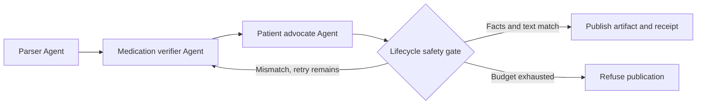
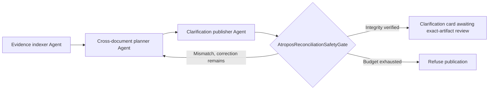
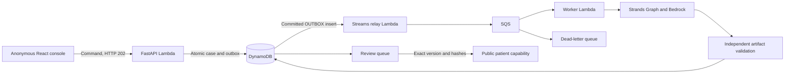

# Atropos MedPlain

Atropos MedPlain uses a Strands SDK Graph to turn multiple synthetic discharge documents into source-cited clarification cards, with a deterministic gate that withholds altered clinical facts.

Built as a prototype for adults leaving hospital with changed medicines and limited support interpreting clinical jargon. The anonymous console keeps conflicting instructions, caregiver questions and original source passages available for review. Its clarification card never supplies a reconciled prescription. A separate simple-note workflow explains invented discharge packets and demonstrates deliberately altered facts being refused and corrected.

[Open the anonymous AWS demo](https://gioep6m26pm3cwvxjp4z4erpmu0zihbk.lambda-url.us-east-1.on.aws/) · [Source and CI](https://github.com/upgradedev/atropos-medplain-aws/actions)

## Try the safety boundary

The first visit opens a collection of **12 prepared synthetic examples** across three desks. The collection includes released, review, rejection and failure scenarios so the table, queues, maps and charts can be explored immediately. Every prepared row is labelled. Available verified artifacts and receipts were prepared with the real Strands SDK and the **offline fixture model in CI**, not a new Bedrock invocation. The prepared failure has no patient artifact. Prepared review decisions and failures are exercises, not visitor actions or reported outages.

The original preparation execution IDs remain bound to their receipts. Cloning examples into an anonymous session gives them new case IDs without relabelling the preparation as a live worker run. Prepared rows have no measured worker duration, submit no outbox messages and consume no inference allowance. Loading the collection again is idempotent. Settings also offers an empty-session path.

To execute the differentiator yourself, create a **new** case:

1. Open the operations console and start a synthetic case using **Catch a tenfold dose change**. Keep the deliberate mutation enabled.
2. The command returns a job immediately. Its captured source and outbox commit together, then a separate worker executes the real Strands Graph through SQS.
3. Open the case drawer. Compare source **Warfarin 2.5 mg QHS** with the verified explanation. The drill changes the first draft to **25 mg** before the gate checks it.
4. Inspect Safety, Agents and Receipt: the gate refuses the changed draft, hands control back to the verifier and validates the rebuilt artifact.
5. This corrected case enters the review queue. Choose the **reviewer demo role**, inspect the exact source and artifact, then release it. Open the resulting public patient view.

The clean pneumonia packet can release automatically under the synthetic demo policy. Interaction flags or a correction require review. A reviewer cannot override a failed clinical gate. The three packets include mL, mcg, BID/TID/QHS, laboratory intervals and stopped medicines. Every record is invented.

The **Safety walkthrough** guides this sequence. It is a product tour, separate from the organizer's required AWS workshop. The original [single-packet demonstration](https://gioep6m26pm3cwvxjp4z4erpmu0zihbk.lambda-url.us-east-1.on.aws/demo) remains available at the same AWS host.

## Import a new synthetic discharge note

In **New case**, choose **Import synthetic note**, load the editable template and change its invented medicines, values or laboratory intervals. The supported `medplain-discharge-note-v1` format is displayed beside the editor. Confirm that the note is invented before submitting. A new import enters the same durable outbox, SQS and Strands workflow as the sample cases.

The parser Agent reads the original numbered source lines and proposes a typed `SourceSelection`: cited line numbers and model-extracted medication/lab fields. Trusted code copies source quotes and follow-up/help text verbatim from those cited original lines, without supplying or repairing clinical fields. The resulting full `SourceExtraction` must exactly match an independent ledger that consumes every source line, including dose strings, units, frequency aliases and `Stop` / `Do not take` negation. The tool does not provide normalized answers. Unsupported or ambiguous input is refused before inference; wrong facts, missing records or incorrect citations are withheld at the SDK hook.

The application retains the exact original note, raw-source SHA-256 and ledger hash. The normalized packet's FHIR identifier includes the raw-source hash, binding it through the existing receipt source digest. Worker persistence, reviewer release and public reads independently reconstruct that binding. Imported cases always require exact-artifact review. The original clinical publication gate remains unchanged.

This is an English ASCII line profile with at most 8,000 characters, 25 lines, six medicines and six labs. It supports new invented names and values within that profile. It is not a general hospital-document parser or PHI detector. The confirmation does not detect or remove private data. Enter only invented information; accepted notes are stored in the anonymous session and sent to its configured model.

## Simple-note comparison with a deterministic baseline

**Settings** displays the source-bound evaluation report and offers its full JSON. CI uses real **Strands Evals `Case`, `Experiment` and deterministic evaluators** to compare the SDK workflow with the full deterministic normalizer, renderer and the same safety gate on the same independent synthetic corpus. The baseline can process every supported input and receives the same validation rules. Per-case outcomes, failures, corpus/ruler hashes and report hash remain available.

The packaged report is labelled **offline fixture execution**, not Bedrock performance. It measures source extraction, supported field fidelity, refusal behavior, corrective trajectories and common-gate mutation rejection. Both arms use the same gate; its rejection results do not establish agent superiority. Accepted patient text is still constrained to the same deterministic renderer, so equal outputs are an expected result. No improvement in patient comprehension or clinical outcomes is claimed.

The separate [evaluation workflow](.github/workflows/evals.yml) can run a bounded comparison against the deployed Bedrock path through its public API. It records actual worker timing separately from client wall time and preserves failed cases. Token use is not measured because a complete usage collector across all nodes is not installed. That manual run is separate from the offline report bundled in the application.

The [first actual Bedrock measurement at 97d5616](https://github.com/upgradedev/atropos-medplain-aws/actions/runs/40940089854) completed zero of six valid imports, while the baseline completed all six. All four unsupported inputs were refused. Every failed import stopped at parser verification without a patient artifact. Those original negative results remain preserved. A workflow completing successfully means its measurement ran; read the report's `measurement_status` and per-case failures before interpreting capability. Subsequent reports identify their own exact source and harness commits.

## Complex discharge packets: clarify across sources

**New case > Reconcile source packet** accepts two to four invented source documents, their supplied issue/effective dates, and an editable caregiver concern in the separate `medplain-reconciliation-v1` profile. Documents can be home lists, discharge orders, addenda, caregiver notes or lab reports. Each document is limited to 6,000 characters; the dossier, including its caregiver concern, is limited to 16,000 characters, 60 nonempty source lines and twelve recognized medication statements. The caregiver concern is limited to 1,000 characters. The selected English or Greek language controls bounded question clauses; original source quotations remain unchanged.

Six examples cover conflicting dose/stop instructions, an explicitly documented intentional change, ordered taper phases, conditional hold/restart wording, product/form confusion, and pending-result follow-up ownership. Source revisions create a new linked case; they do not overwrite the previous case or its evidence.

The useful model task is selecting relevant passages across documents and linking unfamiliar caregiver wording to focused clarification questions. `DischargeEvidenceIndexerAgent` establishes exact source coverage. `CrossDocumentClarificationPlannerAgent` selects cited context and question codes using fresh constraint/reference tools. `ClarificationCardPublisherAgent` references a fresh immutable card. The code independently retains every source statement, recognizes bounded literal clinical atoms, checks structural discrepancies and verifies the entire card before release. It does not infer which document authorizes a medication change from recency alone.

The complex artifact is deliberately a **clarification card**. It contains attributed original quotations, mandatory rule-detected issues, separately labelled agent-proposed context questions and teach-back prompts. Its `patient_regimen` is always null. Original clinical quotations remain untranslated; English or Greek question clauses are deterministic. Unknown wording remains visible for review. Citation integrity does not establish that a model understood a clinical sentence correctly, and an agent proposal is not a verified clinical error. A reviewer can release this exact clarification card, not an inferred prescription. The original simple-note profile still provides its separately gated patient explanation.

Selected warfarin/apixaban with ibuprofen/naproxen appearances produce label-backed review prompts, with the source passages and specific DailyMed references. These are possible exposures to clarify, not proof of concurrent use, a contraindication or an instruction to stop medication. The reference tool uses pinned primary material and eight ingredient-name lookups actually retrieved from NLM. It does not silently substitute products, collapse release forms or clear unknown combinations. The [RxNav interaction service was discontinued](https://lhncbc-portal.lhcaws-prod-pub.nlm.nih.gov/RxNav/information/FAQs.html); RxNorm terminology is not comprehensive interaction data.

The workflow follows [AHRQ MATCH medication reconciliation](https://www.ahrq.gov/patient-safety/settings/hospital/match/chapter-3.html), [RED pending-result follow-up](https://www.ahrq.gov/patient-safety/settings/hospital/red/toolkit/redtool3.html) and [teach-back guidance](https://www.ahrq.gov/health-literacy/improve/precautions/tool5.html). These sources support the workflow design; they do not validate this prototype. Pinned sources, retrieval dates, scope and reference hashes are inspectable in the interface. No universal interaction recall, zero-hallucination or fixed reading-grade claim is made.

The separate **Complex Discharge Evals** corpus has thirty engineering-annotated synthetic dossiers, scored independently against fixed annotations. Both the actual SDK workflow and the complete rule baseline receive the same documents, supported parsers, literal clinical rules, question set and reference snapshots. The baseline also supplies conservative lexical/context planning. Corpus labels and expected answers are not sent to the model. Unknown narrative remains quoted uncertain evidence in both arms. This comparison tests the two implementations; it does not establish that the task requires an LLM.

Independent scores separate source/atom fidelity, proper withholding, structural issues, selected-label review coverage and context-question precision/recall. Fixture mode deliberately replays the rule planner and cannot demonstrate model advantage. Actual Bedrock results, including failures and unexecuted rows, appear separately in Settings after publication for the exact deployed source. Missing results remain explicitly unmeasured.

### Actual complex results: a mixed known-corpus repeat

The [initial actual run at `84bc49e`](https://github.com/upgradedev/atropos-medplain-aws/releases/tag/medplain-reconciliation-84bc49e) delivered 30/30 verified cards with exact supported clinical content, but matched none of fifteen annotated contextual relationships: **TP 0, FP 34, FN 15**. The full baseline scored **TP 4, FP 2, FN 11**. These negative results remain available with their raw report and audit.

After that measurement, planner context presentation, tool scheduling and task instructions changed. The model, clinical gate, output schema, complete baseline, corpus, ruler and reference snapshot remained unchanged. The [repeat at `78d6706`](https://github.com/upgradedev/atropos-medplain-aws/releases/tag/medplain-reconciliation-78d6706) used this now-known corpus. It is not an unseen holdout or a blinded clinical evaluation.

| Metric | Actual Strands / Bedrock at `78d6706` | Full deterministic baseline |
|---|---|---|
| Verified clarification cards | 24/30 | 30/30 |
| Prepublication workflow refusals | 6/30 | 0/30 |
| Complete source coverage | 24/30 | 30/30 |
| Exact source citations | 24/30 | 30/30 |
| Exact supported clinical atoms | 24/30 | 30/30 |
| Verified card with treatment regimen withheld | 24/30 | 30/30 |
| Context-question true positives / false positives / misses | 11 / 12 / 4 | 4 / 2 / 11 |
| Context-question precision | 47.8% | 66.7% |
| Context-question recall | 73.3% | 26.7% |
| Context-question F1 | 0.579 | 0.381 |
| Delivered structural-floor matches | 26/29 | 29/29 |
| Selected-label pair review coverage | 3/4 | 4/4 |

All **24/24 delivered model cards** preserved exact supported source content. The other six cases were refused before publication and had no patient artifact. Case-level fidelity scores retain all thirty cases: a refusal earns no delivered-card credit, rather than being counted as an unsafe release. Structural and selected-label coverage also include the lost coverage from those refusals. Context-question counts score fifteen annotated relationships, rather than thirty case completions.

The repeat found more annotated context relationships, with lower precision and fewer completed cards. It is a mixed outcome, not a clean model win. Unmatched proposed questions are not automatically unsafe medical advice. These engineering annotations do not establish clinical correctness, comprehensive interaction sensitivity, patient comprehension or health benefit. Token use and inference cost are unmeasured. A green measurement workflow means the measurement ran; inspect its raw outcomes and failures before interpreting capability.

### Follow-up after bounded validation feedback

The [actual follow-up at `473c9f4`](https://github.com/upgradedev/atropos-medplain-aws/releases/tag/medplain-reconciliation-473c9f4) retains the same model, clinical contracts, baseline, corpus, ruler, references and inference budgets. The context tool now exposes existing code preconditions, and the existing bounded repair receives the exact validator reason. Rejected selections and final failures have bounded private diagnostics; public patient output excludes them. No citations are filled, questions dropped or baseline plan substituted after model output. This is another known-corpus repeat, not a new holdout.

| Metric | Actual Strands / Bedrock at `473c9f4` | Full deterministic baseline |
|---|---|---|
| Verified cards | 28/30 | 30/30 |
| Prepublication workflow refusals | 2/30 | 0/30 |
| Complete source coverage / exact citations / supported atoms / regimen withheld | 28/30 for each | 30/30 for each |
| Context TP / FP / FN | 12 / 15 / 3 | 4 / 2 / 11 |
| Context precision / recall | 44.4% / 80.0% | 66.7% / 26.7% |
| Context F1 | 0.5714 | 0.3810 |
| Delivered structural matches / selected-pair prompts | 29/29 / 4/4 | 29/29 / 4/4 |

All 28 delivered model cards preserved exact supported clinical content. The other two had no patient artifact: one exhausted the unchanged model-turn limit; one twice proposed an identity question without a required caregiver-context citation and exhausted the existing structured-repair limit. The full report, partial journal and independent audit retain all thirty case denominators and sixty arm outcomes. Compared with `78d6706`, availability and annotated recall improved while precision and F1 worsened slightly. This remains a mixed result.

One concrete contribution is linking both Metoprolol source passages to the caregiver's indirect phrase "my heart pill" and "XL" in one identity/form question. This asks a pharmacist to confirm the formulation; it does not authorize equivalence or substitution. Another example joins two different recorded owners of the same pending result into one ownership question. The baseline retains those records but misses those particular annotated links. These observations support a bounded contextual-association role, not the necessity of an LLM or a claim of clinical benefit.

### Precision intervention: completion fixed, relevance regressed

The [actual known-corpus measurement at `38313f8`](https://github.com/upgradedev/atropos-medplain-aws/releases/tag/medplain-reconciliation-38313f8) changes the planner to Nova Pro, retains Micro for indexing/publication, and provides the exact already-rendered floor questions with a selective policy. Model and prompt changes were evaluated together. The clinical gate, public schemas, renderer, complete baseline, corpus, ruler, references and execution limits are unchanged.

| Metric | Prior Strands `473c9f4` | Strands `38313f8` | Unchanged baseline |
|---|---:|---:|---:|
| Verified cards | 28/30 | 30/30 | 30/30 |
| Workflow refusals | 2 | 0 | 0 |
| Context TP / FP / FN | 12 / 15 / 3 | 9 / 17 / 6 | 4 / 2 / 11 |
| Context precision | 44.4% | 34.6% | 66.7% |
| Context recall | 80.0% | 60.0% | 26.7% |
| Context F1 | 0.5714 | 0.4390 | 0.3810 |
| Additional questions: targeted + generic | 27 + 1 | 26 + 3 | 6 + 12 |
| Source coverage / citations / supported atoms / null regimen | 28/30 each | 30/30 each | 30/30 each |

Both formerly failed controls complete with empty additional-question lists and retained teach-back, in the full comparison and two separate first-job canaries. Availability is fixed, but **precision and recall regress**. The declared accuracy targets were not met. The full baseline question plan remains byte-for-byte identical in its canonical projection. All 60 arm outcomes and the complete partial journal remain public, with independent scoring, source/receipt audits and a sidecar counting generic questions. No failed experiment was replaced.

The 17 false positives comprise ten already-covered floor questions, three redundant broad comparisons, three wrong intents and one incomplete caregiver witness group. Four previous context hits were lost and one gained. This shows why a larger model and a revised policy are not sufficient evidence of improvement.

All 30 delivered cards preserve the supported source content. Structural matches remain 29/29 and selected label-pair prompts 4/4. Completed live roles have 90 successful native outputs and 30 publisher schema-error attempts recovered inside the existing SDK budget. Zero graph-level structured repairs does not mean zero native errors. Model configuration and the SDK trajectory do not independently attest provider-returned model identity. This is a repeat on inspected synthetic cases, not a holdout, clinical validation or a comparison with commercial products. Token use, cost and patient outcomes remain unmeasured.

### Subsequent planner draft: model effectiveness unmeasured

The subsequent source introduces a private `PlanningDraft`: a bounded relationship review precedes the unchanged model-authored `ReconciliationSelection`. The review distinguishes already-covered checks, claimed resolution and proposed questions. Each proposed question must match exactly one `ask` record by intent, ordered source IDs and index. These brief private notes are untrusted action justifications, not verified clinical reasoning, and do not enter the patient artifact.

The planner must repair an inconsistent private draft within the existing budget. The runtime never removes questions, remaps codes, fills citations or substitutes a baseline plan. Relevance and novelty remain unverified model judgments: a coherent but irrelevant or repeated question stays visible to the unchanged scorer. A new relevant caregiver witness, combined conflicting-owner evidence or a distinct relationship with overlapping citations remains allowed. The clinical gate, baseline, public schema, renderer and execution limits remain unchanged. Offline fixtures preserve their complete baseline-backed public plans for all thirty corpus dossiers and six shipped examples; they cannot establish improved model relevance. The latest actual measurement above is `38313f8`, which predates this private draft. No accuracy improvement from the new source is claimed.

Patient views provide larger text, high contrast and manual local-device speech controls with visible unavailable-voice reasons. Speech never starts automatically. This uses the device's supported voices, not Amazon Polly; audio pronunciation and patient comprehension have not been validated. No OCR, unrestricted FHIR import, hospital identity system or autonomous prescribing capability is implied.

## Operations console

React, TypeScript, Tailwind and TanStack Table provide a responsive shell with a collapsible sidebar, counter badges, workspace switcher, `/` search and a user menu. Overview, Cases, Queues, Maps and Settings use the same server-scoped synthetic session. Cases support server filtering, sorting and pagination, with a tabbed detail drawer. Action results use toasts; unavailable APIs, empty cohorts and loading requests have explicit states. Disabled actions state their reason.

Overview charts show persisted case states and desk workload, including the explicitly labelled prepared examples. Measured processing durations include only newly executed jobs; prepared examples contribute no invented latency or operating history. A new case or a retry of a prepared failure/rejection uses the configured worker runtime, which is Bedrock on the public deployment. Search covers the current session and workspace, including cases beyond the loaded table page.

Maps has two views: an interactive agent workflow with recorded trace drill-down, and a geographic map of **synthetic discharge desks** at city-center coordinates. These are demonstration facilities, not patient addresses or real hospital sites. The geographic view bundles generalized Natural Earth country outlines and uses Leaflet for pan, zoom, current-session counts and marker-to-case drill-down. It makes no external tile requests and needs no map API key. The browser never requests the visitor's location.

An opaque anonymous capability scopes the session. Operator, reviewer, auditor and admin are explicitly labelled **synthetic demo lenses**, selectable by the same visitor. The server enforces the selected role and case ownership, but this is not authenticated hospital staff authorization. Sessions and public release capabilities expire after 24 hours. The prepared collection reuses the included source profiles; new invented notes use the bounded intake profile above. Native dropdowns explicitly follow the selected dark or light color scheme, with opaque option backgrounds and readable text.

## What runs

This source configures Amazon Bedrock Nova Pro for the multisource clarification planner, with Nova Micro for evidence indexing, immutable card publication and the separate simple-note workflow. The real `strands-agents==1.53.0` runtime remains load-bearing. Settings and the health response disclose the configured model IDs by role. There is no silent model fallback: a provider error or exhausted correction budget withholds patient content. Offline fixtures do not invoke these models. Each measurement above identifies its own source: the earlier runs use Micro throughout; `38313f8` uses the Pro planner and reports its negative relevance result explicitly. Later source changes are unmeasured until they have their own actual report.

Strands is load-bearing: its `Agent` loop executes the registered tools, its Pydantic output mechanism validates node results, its lifecycle hooks enforce the publication boundary, and its `Graph` routes the correction cycle. Removing Strands breaks the anonymous execution path.

### Simple-note and shipped-sample Graph

| Strands node | Deterministic tools and output |
|---|---|
| `LabAndDischargeParserAgent` | Samples: cross-checks manifest, text and FHIR. New notes: proposes cited lines and typed clinical facts; code copies exact quotes, and the full extraction must match the source ledger |
| `DrugAndContraindicationVerifierAgent` | `medication_dosage_frequency_parity_checker` and `drug_interaction_checker` check dose, unit, frequency, stop status and selected demonstration pairs |
| `PatientAdvocateExplainerAgent` | Calls `grounded_explanation_builder` and returns a typed publication plan for its fresh source-bound artifact. The hook resolves and checks the full `PatientExplanation` before publication |

Each processing generation has a new execution correlation identifier, request context and SDK `agent.state`. DynamoDB retains the captured synthetic source, job version, current generation's result and receipt chain, latest review and case event history. Ordinary retries replace the previous generation's result and review; they do not create a full artifact archive. Live agent objects and model conversation state remain inside their worker invocation. No real patient records are accepted.

The verifier's typed result references the deterministic tool evidence by hash. The tools retain the full parity findings and curated interaction records; the model acknowledges their content references rather than rewriting their clinical classifications. The lifecycle hook requires an exact reference match.

The patient advocate returns a strict publication plan, not clinical prose. Its fresh artifact reference binds the current request, source and invocation. The tool retains an immutable source-grounded explanation; the model cannot add clinical fields or free advice to its plan. Only a valid plan and successful fresh tool call allow the hook to resolve that artifact. The unchanged clinical gate then checks the entire explanation, after any deliberate stress injection. Missing, stale or incorrect references withhold publication. A corrupted tool artifact still fails the independent gate; it is never silently repaired.



The gate compares every supported medication and lab by identity, rather than comparing an unordered bag of numbers. It also requires the entire constrained patient narrative to match the source-derived artifact. This catches swapped doses, changed units, altered frequencies, removed stop orders, extra advice, spelled-out dose changes and source narrative inconsistencies. It does not ask another model to grade the draft.

The stress injector runs after generation and before the gate. It changes both the structured dose and its patient sentence. This is a deliberate engineering drill, not evidence that Bedrock naturally made that error. The Graph permits a bounded correction and withholds output if it still fails.

### Multisource clarification Graph

| Component | Required tools and output boundary |
|---|---|
| `DischargeEvidenceIndexerAgent` | Calls `read_reconciliation_sources` and returns complete source coverage bound to the dossier hash |
| `CrossDocumentClarificationPlannerAgent` | Calls `check_reconciliation_constraints` and `lookup_reconciliation_references`; proposes bounded question codes and original statement IDs while retaining the mandatory structural floor |
| `ClarificationCardPublisherAgent` | Calls `build_clarification_card` and references a fresh immutable artifact bound to the current source, request and invocation |
| `AtroposReconciliationSafetyGate` lifecycle hook | Checks the entire card, original quotes and byte ranges, supported clinical atoms, structural floor, reference binding, null regimen and fresh publication reference |



Every completed invocation requires its own fresh tools. A deliberate comparator or dose mutation happens after generation and before the hook, with the original dossier unchanged. A failed candidate can return to the planner and publisher once; a second failure withholds the card. Verification establishes the supported integrity contract, not a resolved treatment plan or the clinical truth of a contextual proposal. Every new dossier requires review, and even a released card keeps `patient_regimen: null`.

### Durable AWS command path



The command path uses a transactional outbox rather than an uncoordinated database write and queue send. Queue messages contain identifiers and a generation, never clinical documents or API session tokens. Conditional claims, expiring leases and version fencing prevent stale attempts from committing over newer work. SQS may deliver duplicates and a crashed worker may repeat inference. The guarantee is a conditional accepted publication, not exactly-once model execution.

A worker independently rechecks saved source, full artifact and receipt integrity before persistence. Review and public reads repeat that validation. A review binds the current record version, source hash and artifact hash. It cannot approve a different candidate or bypass a refused gate.

## Safety and scope

This is a synthetic engineering demonstration, not a medical device or clinical advice. Source fidelity does not establish that a source prescription is appropriate. Do not use these invented medicine plans for your own care.

The simple-note input is a deliberately narrow discharge table and FHIR `Bundle` profile containing `MedicationRequest` and `Observation` resources, plus a canonical discharge narrative. The API accepts shipped sample identifiers and explicitly confirmed invented notes in the displayed line profile. It independently compiles new notes into that same canonical packet contract. The separate multisource profile accepts two to four bounded synthetic text documents and a caregiver concern for a clarification card only, under the limits above. Arbitrary FHIR bundles, PDFs, EHR uploads, hospital portal connections and automatic discharge-finalization triggers are not deployed.

Clinical prose is constrained to source-grounded templates. The agents select and verify tool evidence; unrestricted model-written medical advice is intentionally outside the publication contract. No reading grade, patient comprehension, readmission benefit or clinical outcome has been measured.

The interaction matrix covers only the named demonstration pairs. An absent flag does **not** clear an unknown combination. Flags are pharmacist-review prompts, including when one medicine is stopped. References: [lisinopril labeling](https://dailymed.nlm.nih.gov/dailymed/drugInfo.cfm?setid=7885537f-88b2-4d39-bcd2-cad9b2e5fbe5), [NHS warfarin medicine guidance](https://www.nhs.uk/medicines/warfarin/).

Receipts bind a canonical source hash, candidate artifact hash, verdict, discrepancies, session, sequence and previous hash. The artifact digest covers the structured explanation and rendered text. The chain is **unsigned**. It detects edited or reordered entries; it does not establish authenticity, medical correctness, or completeness without an externally retained final hash. There is no blockchain, clinical certification or external timestamp authority.

## Run and verify

The demo needs only a browser. Dependency installation, package builds and Chromium execution run in GitHub Actions, rather than on the constrained authoring workstation. See the [CI workflow](.github/workflows/ci.yml) and downloadable evidence on its green runs.

For a separate Linux development environment with Python 3.12:

```bash
python -m pip install -e '.[test,eval]'
python scripts/build_prepared_demo.py --output src/medplain/data/prepared_demo.json --source-commit "$(git rev-parse HEAD)"
python scripts/evaluate_medplain.py --mode fixture --source-commit "$(git rev-parse HEAD)" --output src/medplain/data/evaluation_report.json
cd web && npm ci && npm run build && cd ..
python scripts/stage_console.py
MEDPLAIN_MODEL_MODE=fixture uvicorn medplain.api:app --host 127.0.0.1 --port 8000
```

Local fixture mode uses explicit in-memory operations storage and background dispatch. A configured DynamoDB outage never falls back to memory. Fixture mode replaces the inference adapter with a bounded deterministic model that emits genuine SDK tool-use events. It still runs real Strands Agents, tools, structured output, hooks and Graph edges. It is explicitly labeled offline in the UI and requires no AWS credentials.

```bash
python scripts/check_source.py
ruff check src tests scripts
python scripts/offline_tests.py -q --cov=medplain --cov-report=term-missing
```

The offline test runner refuses network socket connections. The suite mutates independent dose, unit, frequency, stop-order, narrative, FHIR, lab-range, receipt and session fixtures, then exercises the actual anonymous API and SDK correction cycle. Tests prove the gate rejects deliberately broken inputs; success is not inferred from file existence.

CI prepares the offline SDK collection once, validates its clinical evidence and binds the same JSON bytes into the wheel and Lambda package. The API never generates substitute model evidence when that bundle is unavailable. CI installs Chromium and runs all samples at desktop, including receipt download and verification, plus the stress journey at 375px. Console checks also exercise the prepared first visit, explicit empty-session escape, provenance, and dropdown contrast and keyboard behavior. The workflow can be dispatched with `judge_url` to require HTTP 200, the deployed commit, live Bedrock execution, a refused/corrected stress drill, receipt tamper rejection and the deployed mobile journey. A source CI run without that URL does not establish live readiness.

For Bedrock mode, set `MEDPLAIN_MODEL_MODE=bedrock`, `MEDPLAIN_BEDROCK_MODEL_ID=amazon.nova-micro-v1:0` and `AWS_REGION=us-east-1`, with an AWS identity allowed to invoke that model. The runtime does not accept credentials through the browser.

## AWS deployment

CI builds a Linux Python 3.12 Lambda zip and a SHA-256 manifest containing the exact source commit. Download that artifact, then run `scripts/deploy_aws.py` with `--account`, `--package` and `--commit`. Its default prints a plan; `--apply` deploys the reviewed artifact. The helper refuses a different AWS account, a mismatched package hash or commit, and existing resources without the project ownership tag.

Deployment uses only project-tagged `atropos-medplain` resources: the public API Lambda, separate outbox-relay and Strands-worker Lambdas, encrypted DynamoDB with TTL and point-in-time recovery, SQS with a dead-letter queue, and CloudWatch logs and alarms. Each role has scoped table, stream, queue, log and model access for its task. The API retains Bedrock permission for the original `/api/explain` path. No AWS credentials reach the browser.

A private encrypted S3 bucket stages content-addressed CI packages with expiring release objects; it is not a clinical evidence archive. Reserved concurrency, bounded SDK execution, a per-session case limit and a daily operations job allowance control this demo's workload. The daily allowance applies to queued operations jobs, not all AWS requests or the legacy endpoint, so it is not a total spend cap. Logs have finite retention. There are no always-running compute instances.

CloudWatch alarms cover failed workers, outbox delivery and queue health. Notification subscribers are not configured. Step Functions, AgentCore, SNS and EventBridge are not deployed. Strands already owns the agent graph; a future timed escalation, isolated agent runtime or independent event subscriber would provide a concrete reason to add those services.

### Well-Architected design review

This is a bounded demonstration, not a certification or a complete Well-Architected review. The implemented choices relate to these current AWS best practices, with the remaining gaps stated explicitly:

| AWS practice | Concrete mechanism | Remaining gap |
|---|---|---|
| [REL04-BP02, loosely coupled dependencies](https://docs.aws.amazon.com/wellarchitected/latest/framework/rel_prevent_interaction_failure_loosely_coupled_system.html) | HTTP 202, transactional outbox, queue and separate worker | API and worker still share a bounded-context table; no regional failover |
| [REL04-BP04, idempotent mutating operations](https://docs.aws.amazon.com/wellarchitected/latest/framework/rel_prevent_interaction_failure_idempotent.html) | Command keys, conditional claims, generation/version fencing | A crashed attempt can repeat inference; no exactly-once claim |
| [REL05-BP04, fail fast and limit queues](https://docs.aws.amazon.com/wellarchitected/latest/framework/rel_mitigate_interaction_failure_fail_fast.html) | Bounded execution, job allowance, DLQ and queue alarms | No measured recovery-time objective or staffed alarm subscriber |
| [SEC03-BP02, least privilege](https://docs.aws.amazon.com/wellarchitected/latest/framework/sec_permissions_least_privileges.html) | Separate AWS roles and scoped resources; session capability isolation | Demo role selection is not staff identity; no real health-data deployment assessment |
| [OPS04-BP02, application telemetry](https://docs.aws.amazon.com/wellarchitected/latest/framework/ops_observability_application_telemetry.html) | Correlated persisted job events, measured duration and CloudWatch metrics | No cross-service distributed trace or user-outcome measurement |

Performance, cost and sustainability choices include asynchronous browser commands, bounded workers, short synthetic retention and avoiding unused services. Load testing, a full account budget policy and measured sustainability outcomes remain outside this demonstration.

To verify an actual deployment, use the command below with the live URL and the artifact's full commit. It fails on non-200 responses or any missing flagship behavior.

```bash
python scripts/live_smoke.py 'YOUR_PUBLIC_AWS_URL' --expected-commit 'FULL_SOURCE_COMMIT'
python scripts/ops_live_smoke.py 'YOUR_PUBLIC_AWS_URL' --expected-commit 'FULL_SOURCE_COMMIT'
```

## Pre-existing open-source patterns

| Source | Reused pattern and boundary |
|---|---|
| [Strands Agents Python SDK](https://github.com/strands-agents/sdk-python), Apache-2.0 | Public `Agent`, `@tool`, Graph, lifecycle hook, structured-output and custom-model interfaces. The SDK is a pinned runtime dependency. |
| [Strands Evals](https://github.com/strands-agents/evals/tree/v1.7.0) | Pinned optional evaluation dependency. Public `Case`, `Experiment` and custom evaluator interfaces; corpus, literal annotations, deterministic clinical/trajectory scorers and full baseline written for this project. |
| [Lachesis](https://github.com/upgradedev/lachesis-guard), MIT | Conceptual inspiration: deterministic decisions at an SDK lifecycle seam and request/session-bound state. Inspected read-only. No Lachesis code, benchmark, model, fixtures or product was copied. |
| FastAPI, Pydantic and Mangum | Standard open-source web, schema and Lambda adapter dependencies, declared in `pyproject.toml`. |
| React, TypeScript, Vite, Tailwind, TanStack Table and Leaflet | Public component, build, styling, table and map APIs; dependencies declared in `web/package.json`. |
| [Natural Earth country geometry](https://github.com/nvkelso/natural-earth-vector/blob/ca96624a56bd078437bca8184e78163e5039ad19/geojson/ne_110m_admin_0_countries.geojson), [public domain](https://www.naturalearthdata.com/about/terms-of-use/) | Bundled 1:110m outlines for Greece and twelve surrounding countries. Only country names/codes and source geometry are retained, with coordinates rounded to five decimal places. Full source URL, commit, SHA-256 and transformation are recorded in `web/src/data/greece-region.geojson.json`. These generalized outlines are not street maps or precise facility locations. |
| AWS transactional outbox guidance | Architectural pattern for committed job events, idempotent consumption and durable queue handoff; implementation written for this project. |

An owner-provided private operations console was inspected read-only for generic navigation and master-detail behavior. No private code, assets, domain data or configuration was copied. The clinical contracts, source profile, templates, safety gate, receipt chain, stress injector, fixtures, operations domain, UI and orchestration wiring were written for this project. Every packet is invented. No customer code or patient records are included. Project code is [MIT licensed](LICENSE).
