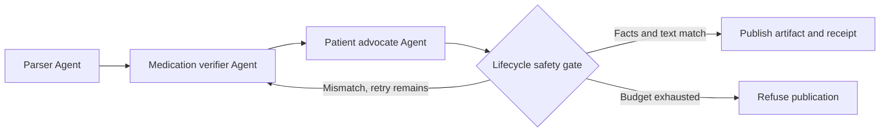
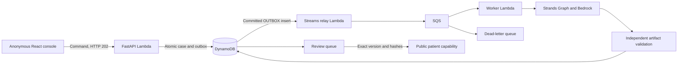

# Atropos MedPlain

Atropos MedPlain uses a Strands SDK Graph to withhold discharge explanations when a clinical fact changes.

Built for adults leaving hospital with changed medicines and limited support interpreting clinical jargon. The anonymous demo explains invented discharge packets, preserves their clinical facts, and shows a deliberately altered dose being refused and corrected.

[Open the anonymous AWS demo](https://gioep6m26pm3cwvxjp4z4erpmu0zihbk.lambda-url.us-east-1.on.aws/) · [Source and CI](https://github.com/upgradedev/atropos-medplain-aws/actions)

## Try the safety boundary

The first visit opens a collection of **12 prepared synthetic examples** across three desks. The collection includes released, review, rejection and failure scenarios so the table, queues, maps and charts can be explored immediately. Every prepared row is labelled. Available verified artifacts and receipts were prepared with the real Strands SDK and the **offline fixture model in CI**, not a new Bedrock invocation. The prepared failure has no patient artifact. Prepared review decisions and failures are exercises, not visitor actions or reported outages.

The original preparation execution IDs remain bound to their receipts. Cloning examples into an anonymous session gives them new case IDs without relabelling the preparation as a live worker run. Prepared rows have no measured worker duration, submit no outbox messages and consume no inference allowance. Loading the collection again is idempotent. Settings also offers an empty-session path.

To execute the differentiator yourself, create a **new** case:

1. Open the operations console and start a synthetic case using **Catch a tenfold dose change**. Keep the deliberate mutation enabled.
2. The command returns a job immediately. Its captured source and outbox commit together, then a separate worker executes the real Strands Graph through SQS.
3. Open the case drawer. Compare source **Warfarin 2.5 mg QHS** with the verified explanation. The drill changes the first draft to **25 mg** before the gate checks it.
4. Inspect Safety, Agents and Receipt: the gate refuses the changed draft, hands control back to the verifier and validates the rebuilt artifact.
5. This corrected case enters the review queue. Choose the **reviewer demo role**, inspect the exact source and artifact, then release it. Open the resulting public patient view.

The clean pneumonia packet can release automatically under the synthetic demo policy. Interaction flags or a correction require review. A reviewer cannot override a failed clinical gate. The three packets include mL, mcg, BID/TID/QHS, laboratory intervals and stopped medicines. Every record is invented.

The **Safety walkthrough** guides this sequence. It is a product tour, separate from the organizer's required AWS workshop. The original [single-packet demonstration](https://gioep6m26pm3cwvxjp4z4erpmu0zihbk.lambda-url.us-east-1.on.aws/demo) remains available at the same AWS host.

## Operations console

React, TypeScript, Tailwind and TanStack Table provide a responsive shell with a collapsible sidebar, counter badges, workspace switcher, `/` search and a user menu. Overview, Cases, Queues, Maps and Settings use the same server-scoped synthetic session. Cases support server filtering, sorting and pagination, with a tabbed detail drawer. Action results use toasts; unavailable APIs, empty cohorts and loading requests have explicit states. Disabled actions state their reason.

Overview charts show persisted case states and desk workload, including the explicitly labelled prepared examples. Measured processing durations include only newly executed jobs; prepared examples contribute no invented latency or operating history. A new case or a retry of a prepared failure/rejection uses the configured worker runtime, which is Bedrock on the public deployment. Search covers the current session and workspace, including cases beyond the loaded table page.

Maps has two views: an interactive agent workflow with recorded trace drill-down, and a geographic map of **synthetic discharge desks** at city-center coordinates. These are demonstration facilities, not patient addresses or real hospital sites. The geographic view bundles generalized Natural Earth country outlines and uses Leaflet for pan, zoom, current-session counts and marker-to-case drill-down. It makes no external tile requests and needs no map API key. The browser never requests the visitor's location.

An opaque anonymous capability scopes the session. Operator, reviewer, auditor and admin are explicitly labelled **synthetic demo lenses**, selectable by the same visitor. The server enforces the selected role and case ownership, but this is not authenticated hospital staff authorization. Sessions and public release capabilities expire after 24 hours. The prepared collection reuses the included source profiles; arbitrary patient input is still unavailable. Native dropdowns explicitly follow the selected dark or light color scheme, with opaque option backgrounds and readable text.

## What runs

The public AWS route uses Amazon Bedrock Nova Micro and the real `strands-agents==1.53.0` runtime. It has no silent inference fallback. A provider error or an exhausted correction budget withholds patient content. The screen identifies the active model mode.

Strands is load-bearing: its `Agent` loop executes the registered tools, its Pydantic output mechanism validates node results, its lifecycle hooks enforce the publication boundary, and its `Graph` routes the correction cycle. Removing Strands breaks the anonymous execution path.

| Strands node | Deterministic tools and output |
|---|---|
| `LabAndDischargeParserAgent` | `lab_reference_range_evaluator` checks the source text against the manifest and FHIR profile, then evaluates supplied lab intervals |
| `DrugAndContraindicationVerifierAgent` | `medication_dosage_frequency_parity_checker` and `drug_interaction_checker` check dose, unit, frequency, stop status and selected demonstration pairs |
| `PatientAdvocateExplainerAgent` | `grounded_explanation_builder` produces a constrained `PatientExplanation`; the `AfterInvocationEvent` hook checks it before publication |

Each processing generation has a new execution correlation identifier, request context and SDK `agent.state`. DynamoDB retains the captured synthetic source, job version, result, receipt chain and review history. Live agent objects and model conversation state remain inside their worker invocation. No real patient records are accepted.

The verifier's typed result references the deterministic tool evidence by hash. The tools retain the full parity findings and curated interaction records; the model acknowledges their content references rather than rewriting their clinical classifications. The lifecycle hook requires an exact reference match. The patient advocate still returns the full structured explanation, which faces the independent clinical publication gate.



The gate compares every supported medication and lab by identity, rather than comparing an unordered bag of numbers. It also requires the entire constrained patient narrative to match the source-derived artifact. This catches swapped doses, changed units, altered frequencies, removed stop orders, extra advice, spelled-out dose changes and source narrative inconsistencies. It does not ask another model to grade the draft.

The stress injector runs after generation and before the gate. It changes both the structured dose and its patient sentence. This is a deliberate engineering drill, not evidence that Bedrock naturally made that error. The Graph permits a bounded correction and withholds output if it still fails.



The command path uses a transactional outbox rather than an uncoordinated database write and queue send. Queue messages contain identifiers and a generation, never clinical documents or API session tokens. Conditional claims, expiring leases and version fencing prevent stale attempts from committing over newer work. SQS may deliver duplicates and a crashed worker may repeat inference. The guarantee is a conditional accepted publication, not exactly-once model execution.

A worker independently rechecks saved source, full artifact and receipt integrity before persistence. Review and public reads repeat that validation. A review binds the current record version, source hash and artifact hash. It cannot approve a different candidate or bypass a refused gate.

## Safety and scope

This is a synthetic engineering demonstration, not a medical device or clinical advice. Source fidelity does not establish that a source prescription is appropriate. Do not use these invented medicine plans for your own care.

The supported input is a deliberately narrow discharge table and FHIR `Bundle` profile containing `MedicationRequest` and `Observation` resources, plus a canonical discharge narrative. The API accepts only identifiers for the shipped samples. Arbitrary FHIR bundles, PDFs, EHR uploads, hospital portal connections and automatic discharge-finalization triggers are not deployed.

Clinical prose is constrained to source-grounded templates. The agents select and verify tool evidence; unrestricted model-written medical advice is intentionally outside the publication contract. No reading grade, patient comprehension, readmission benefit or clinical outcome has been measured.

The interaction matrix covers only the named demonstration pairs. An absent flag does **not** clear an unknown combination. Flags are pharmacist-review prompts, including when one medicine is stopped. References: [lisinopril labeling](https://dailymed.nlm.nih.gov/dailymed/drugInfo.cfm?setid=7885537f-88b2-4d39-bcd2-cad9b2e5fbe5), [NHS warfarin medicine guidance](https://www.nhs.uk/medicines/warfarin/).

Receipts bind a canonical source hash, candidate artifact hash, verdict, discrepancies, session, sequence and previous hash. The artifact digest covers the structured explanation and rendered text. The chain is **unsigned**. It detects edited or reordered entries; it does not establish authenticity, medical correctness, or completeness without an externally retained final hash. There is no blockchain, clinical certification or external timestamp authority.

## Run and verify

The demo needs only a browser. Dependency installation, package builds and Chromium execution run in GitHub Actions, rather than on the constrained authoring workstation. See the [CI workflow](.github/workflows/ci.yml) and downloadable evidence on its green runs.

For a separate Linux development environment with Python 3.12:

```bash
python -m pip install -e '.[test]'
python scripts/build_prepared_demo.py --output src/medplain/data/prepared_demo.json --source-commit "$(git rev-parse HEAD)"
cd web && npm ci && npm run build && cd ..
python scripts/stage_console.py
MEDPLAIN_MODEL_MODE=fixture uvicorn medplain.api:app --host 127.0.0.1 --port 8000
```

Local fixture mode uses explicit in-memory operations storage and background dispatch. A configured DynamoDB outage never falls back to memory. Fixture mode replaces the inference adapter with a bounded deterministic model that emits genuine SDK tool-use events. It still runs real Strands Agents, tools, structured output, hooks and Graph edges. It is explicitly labeled offline in the UI and requires no AWS credentials.

```bash
python scripts/check_source.py
ruff check src tests scripts
python scripts/offline_tests.py -q --cov=medplain --cov-report=term-missing
```

The offline test runner refuses network socket connections. The suite mutates independent dose, unit, frequency, stop-order, narrative, FHIR, lab-range, receipt and session fixtures, then exercises the actual anonymous API and SDK correction cycle. Tests prove the gate rejects deliberately broken inputs; success is not inferred from file existence.

CI prepares the offline SDK collection once, validates its clinical evidence and binds the same JSON bytes into the wheel and Lambda package. The API never generates substitute model evidence when that bundle is unavailable. CI installs Chromium and runs all samples at desktop, including receipt download and verification, plus the stress journey at 375px. Console checks also exercise the prepared first visit, explicit empty-session escape, provenance, and dropdown contrast and keyboard behavior. The workflow can be dispatched with `judge_url` to require HTTP 200, the deployed commit, live Bedrock execution, a refused/corrected stress drill, receipt tamper rejection and the deployed mobile journey. A source CI run without that URL does not establish live readiness.

For Bedrock mode, set `MEDPLAIN_MODEL_MODE=bedrock`, `MEDPLAIN_BEDROCK_MODEL_ID=amazon.nova-micro-v1:0` and `AWS_REGION=us-east-1`, with an AWS identity allowed to invoke that model. The runtime does not accept credentials through the browser.

## AWS deployment

CI builds a Linux Python 3.12 Lambda zip and a SHA-256 manifest containing the exact source commit. Download that artifact, then run `scripts/deploy_aws.py` with `--account`, `--package` and `--commit`. Its default prints a plan; `--apply` deploys the reviewed artifact. The helper refuses a different AWS account, a mismatched package hash or commit, and existing resources without the project ownership tag.

Deployment uses only project-tagged `atropos-medplain` resources: the public API Lambda, separate outbox-relay and Strands-worker Lambdas, encrypted DynamoDB with TTL and point-in-time recovery, SQS with a dead-letter queue, and CloudWatch logs and alarms. Each role has scoped table, stream, queue, log and model access for its task. The API retains Bedrock permission for the original `/api/explain` path. No AWS credentials reach the browser.

A private encrypted S3 bucket stages content-addressed CI packages with expiring release objects; it is not a clinical evidence archive. Reserved concurrency, bounded SDK execution, a per-session case limit and a daily operations job allowance control this demo's workload. The daily allowance applies to queued operations jobs, not all AWS requests or the legacy endpoint, so it is not a total spend cap. Logs have finite retention. There are no always-running compute instances.

CloudWatch alarms cover failed workers, outbox delivery and queue health. Notification subscribers are not configured. Step Functions, AgentCore, SNS and EventBridge are not deployed. Strands already owns the agent graph; a future timed escalation, isolated agent runtime or independent event subscriber would provide a concrete reason to add those services.

### Well-Architected design review

This is a bounded demonstration, not a certification or a complete Well-Architected review. The implemented choices relate to these current AWS best practices, with the remaining gaps stated explicitly:

| AWS practice | Concrete mechanism | Remaining gap |
|---|---|---|
| [REL04-BP02, loosely coupled dependencies](https://docs.aws.amazon.com/wellarchitected/latest/framework/rel_prevent_interaction_failure_loosely_coupled_system.html) | HTTP 202, transactional outbox, queue and separate worker | API and worker still share a bounded-context table; no regional failover |
| [REL04-BP04, idempotent mutating operations](https://docs.aws.amazon.com/wellarchitected/latest/framework/rel_prevent_interaction_failure_idempotent.html) | Command keys, conditional claims, generation/version fencing | A crashed attempt can repeat inference; no exactly-once claim |
| [REL05-BP04, fail fast and limit queues](https://docs.aws.amazon.com/wellarchitected/latest/framework/rel_mitigate_interaction_failure_fail_fast.html) | Bounded execution, job allowance, DLQ and queue alarms | No measured recovery-time objective or staffed alarm subscriber |
| [SEC03-BP02, least privilege](https://docs.aws.amazon.com/wellarchitected/latest/framework/sec_permissions_least_privileges.html) | Separate AWS roles and scoped resources; session capability isolation | Demo role selection is not staff identity; no real health-data deployment assessment |
| [OPS04-BP02, application telemetry](https://docs.aws.amazon.com/wellarchitected/latest/framework/ops_observability_application_telemetry.html) | Correlated persisted job events, measured duration and CloudWatch metrics | No cross-service distributed trace or user-outcome measurement |

Performance, cost and sustainability choices include asynchronous browser commands, bounded workers, short synthetic retention and avoiding unused services. Load testing, a full account budget policy and measured sustainability outcomes remain outside this demonstration.

To verify an actual deployment, use the command below with the live URL and the artifact's full commit. It fails on non-200 responses or any missing flagship behavior.

```bash
python scripts/live_smoke.py 'YOUR_PUBLIC_AWS_URL' --expected-commit 'FULL_SOURCE_COMMIT'
python scripts/ops_live_smoke.py 'YOUR_PUBLIC_AWS_URL' --expected-commit 'FULL_SOURCE_COMMIT'
```

## Pre-existing open-source patterns

| Source | Reused pattern and boundary |
|---|---|
| [Strands Agents Python SDK](https://github.com/strands-agents/sdk-python), Apache-2.0 | Public `Agent`, `@tool`, Graph, lifecycle hook, structured-output and custom-model interfaces. The SDK is a pinned runtime dependency. |
| [Lachesis](https://github.com/upgradedev/lachesis-guard), MIT | Conceptual inspiration: deterministic decisions at an SDK lifecycle seam and request/session-bound state. Inspected read-only. No Lachesis code, benchmark, model, fixtures or product was copied. |
| FastAPI, Pydantic and Mangum | Standard open-source web, schema and Lambda adapter dependencies, declared in `pyproject.toml`. |
| React, TypeScript, Vite, Tailwind, TanStack Table and Leaflet | Public component, build, styling, table and map APIs; dependencies declared in `web/package.json`. |
| [Natural Earth country geometry](https://github.com/nvkelso/natural-earth-vector/blob/ca96624a56bd078437bca8184e78163e5039ad19/geojson/ne_110m_admin_0_countries.geojson), [public domain](https://www.naturalearthdata.com/about/terms-of-use/) | Bundled 1:110m outlines for Greece and twelve surrounding countries. Only country names/codes and source geometry are retained, with coordinates rounded to five decimal places. Full source URL, commit, SHA-256 and transformation are recorded in `web/src/data/greece-region.geojson.json`. These generalized outlines are not street maps or precise facility locations. |
| AWS transactional outbox guidance | Architectural pattern for committed job events, idempotent consumption and durable queue handoff; implementation written for this project. |

An owner-provided private operations console was inspected read-only for generic navigation and master-detail behavior. No private code, assets, domain data or configuration was copied. The clinical contracts, source profile, templates, safety gate, receipt chain, stress injector, fixtures, operations domain, UI and orchestration wiring were written for this project. Every packet is invented. No customer code or patient records are included. Project code is [MIT licensed](LICENSE).
