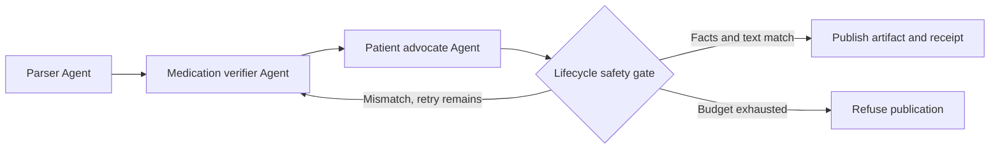
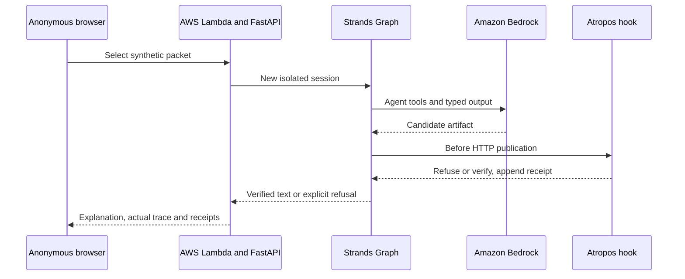

# Atropos MedPlain

Atropos MedPlain uses a Strands SDK Graph to withhold discharge explanations when a clinical fact changes.

Built for adults leaving hospital with changed medicines and limited support interpreting clinical jargon. The anonymous demo explains invented discharge packets, preserves their clinical facts, and shows a deliberately altered dose being refused and corrected.

[Open the anonymous AWS demo](https://gioep6m26pm3cwvxjp4z4erpmu0zihbk.lambda-url.us-east-1.on.aws/) · [Source and CI](https://github.com/upgradedev/atropos-medplain-aws/actions)

## Try the safety boundary

1. Open the demo and choose **Catch a tenfold dose change**.
2. Leave **Inject a deliberate dosage error** selected and press **Explain this packet**.
3. Compare source **Warfarin 2.5 mg QHS** with the verified patient explanation. The drill changes the first draft to **25 mg** before publication.
4. Inspect the actual Strands handoff trail: the gate refuses the changed draft, routes to the verifier, and checks a rebuilt explanation.
5. Download the JSON receipt and press **Verify receipt chain**. Its first decision is refused; its second is verified.

The other packets demonstrate liquid doses in mL, doses in mcg, BID/TID/QHS frequency preservation, source laboratory ranges, and a stopped medicine. No account, API key, upload or patient data is needed. You can turn the fault injection off to compare normal execution.

## What runs

The public AWS route uses Amazon Bedrock Nova Micro and the real `strands-agents==1.53.0` runtime. It has no silent inference fallback. A provider error or an exhausted correction budget withholds patient content. The screen identifies the active model mode.

Strands is load-bearing: its `Agent` loop executes the registered tools, its Pydantic output mechanism validates node results, its lifecycle hooks enforce the publication boundary, and its `Graph` routes the correction cycle. Removing Strands breaks the anonymous execution path.

| Strands node | Deterministic tools and output |
|---|---|
| `LabAndDischargeParserAgent` | `lab_reference_range_evaluator` checks the source text against the manifest and FHIR profile, then evaluates supplied lab intervals |
| `DrugAndContraindicationVerifierAgent` | `medication_dosage_frequency_parity_checker` and `drug_interaction_checker` check dose, unit, frequency, stop status and selected demonstration pairs |
| `PatientAdvocateExplainerAgent` | `grounded_explanation_builder` produces a constrained `PatientExplanation`; the `AfterInvocationEvent` hook checks it before publication |

Each request has a new session identifier, shared request context and SDK `agent.state`. Correction state and receipt links remain inside that request. No health record database or persistent patient session is deployed.



The gate compares every supported medication and lab by identity, rather than comparing an unordered bag of numbers. It also requires the entire constrained patient narrative to match the source-derived artifact. This catches swapped doses, changed units, altered frequencies, removed stop orders, extra advice, spelled-out dose changes and source narrative inconsistencies. It does not ask another model to grade the draft.

The stress injector runs after generation and before the gate. It changes both the structured dose and its patient sentence. This is a deliberate engineering drill, not evidence that Bedrock naturally made that error. The Graph permits a bounded correction and withholds output if it still fails.



## Safety and scope

This is a synthetic engineering demonstration, not a medical device or clinical advice. Source fidelity does not establish that a source prescription is appropriate. Do not use these invented medicine plans for your own care.

The supported input is a deliberately narrow discharge table and FHIR `Bundle` profile containing `MedicationRequest` and `Observation` resources, plus a canonical discharge narrative. The API accepts only identifiers for the shipped samples. Arbitrary FHIR bundles, PDFs, EHR uploads, hospital portal connections and automatic discharge-finalization triggers are not deployed.

Clinical prose is constrained to source-grounded templates. The agents select and verify tool evidence; unrestricted model-written medical advice is intentionally outside the publication contract. No reading grade, patient comprehension, readmission benefit or clinical outcome has been measured.

The interaction matrix covers only the named demonstration pairs. An absent flag does **not** clear an unknown combination. Flags are pharmacist-review prompts, including when one medicine is stopped. References: [lisinopril labeling](https://dailymed.nlm.nih.gov/dailymed/drugInfo.cfm?setid=7885537f-88b2-4d39-bcd2-cad9b2e5fbe5), [NHS warfarin medicine guidance](https://www.nhs.uk/medicines/warfarin/).

Receipts bind a canonical source hash, candidate artifact hash, verdict, discrepancies, session, sequence and previous hash. The artifact digest covers the structured explanation and rendered text. The chain is **unsigned**. It detects edited or reordered entries; it does not establish authenticity, medical correctness, or completeness without an externally retained final hash. There is no blockchain, clinical certification or external timestamp authority.

## Run and verify

The demo needs only a browser. Dependency installation, package builds and Chromium execution run in GitHub Actions, rather than on the constrained authoring workstation. See the [CI workflow](.github/workflows/ci.yml) and downloadable evidence on its green runs.

For a separate Linux development environment with Python 3.12:

```bash
python -m pip install -e '.[test]'
MEDPLAIN_MODEL_MODE=fixture uvicorn medplain.api:app --host 127.0.0.1 --port 8000
```

Fixture mode replaces the inference adapter with a bounded deterministic model that emits genuine SDK tool-use events. It still runs real Strands Agents, tools, structured output, hooks and Graph edges. It is explicitly labeled offline in the UI and requires no AWS credentials.

```bash
python scripts/check_source.py
ruff check src tests scripts
python scripts/offline_tests.py -q --cov=medplain --cov-report=term-missing
```

The offline test runner refuses network socket connections. The suite mutates independent dose, unit, frequency, stop-order, narrative, FHIR, lab-range, receipt and session fixtures, then exercises the actual anonymous API and SDK correction cycle. Tests prove the gate rejects deliberately broken inputs; success is not inferred from file existence.

CI installs Chromium and runs all samples at desktop and 375px, including receipt download and verification. The workflow can also be dispatched with `judge_url` to require HTTP 200, the deployed commit, live Bedrock execution, a refused/corrected stress drill, receipt tamper rejection and the deployed mobile journey. A source CI run without that URL does not establish live readiness.

For Bedrock mode, set `MEDPLAIN_MODEL_MODE=bedrock`, `MEDPLAIN_BEDROCK_MODEL_ID=amazon.nova-micro-v1:0` and `AWS_REGION=us-east-1`, with an AWS identity allowed to invoke that model. The runtime does not accept credentials through the browser.

## AWS deployment

CI builds a Linux Python 3.12 Lambda zip and a SHA-256 manifest containing the exact source commit. Download that artifact, then run `scripts/deploy_aws.py` with `--account`, `--package` and `--commit`. Its default prints a plan; `--apply` deploys the reviewed artifact. The helper refuses a different AWS account, a mismatched package hash or commit, and existing resources without the project ownership tag.

Deployment creates only dedicated `atropos-medplain` resources: a Lambda function, an execution role scoped to its log group and the named Bedrock model, a public Function URL and the two required URL invocation permissions. Reserved concurrency is limited, execution time is bounded, and logs have finite retention. There are no always-running compute instances. Request-based AWS charges still apply; concurrency is not a total spend cap.

To verify an actual deployment, use the command below with the live URL and the artifact's full commit. It fails on non-200 responses or any missing flagship behavior.

```bash
python scripts/live_smoke.py 'YOUR_PUBLIC_AWS_URL' --expected-commit 'FULL_SOURCE_COMMIT'
```

## Pre-existing open-source patterns

| Source | Reused pattern and boundary |
|---|---|
| [Strands Agents Python SDK](https://github.com/strands-agents/sdk-python), Apache-2.0 | Public `Agent`, `@tool`, Graph, lifecycle hook, structured-output and custom-model interfaces. The SDK is a pinned runtime dependency. |
| [Lachesis](https://github.com/upgradedev/lachesis-guard), MIT | Conceptual inspiration: deterministic decisions at an SDK lifecycle seam and request/session-bound state. Inspected read-only. No Lachesis code, benchmark, model, fixtures or product was copied. |
| FastAPI, Pydantic and Mangum | Standard open-source web, schema and Lambda adapter dependencies, declared in `pyproject.toml`. |

The clinical contracts, source profile, templates, safety gate, receipt chain, stress injector, fixtures, UI and orchestration wiring were written for this project. Every packet is invented. No customer code or patient records are included. Project code is [MIT licensed](LICENSE).
